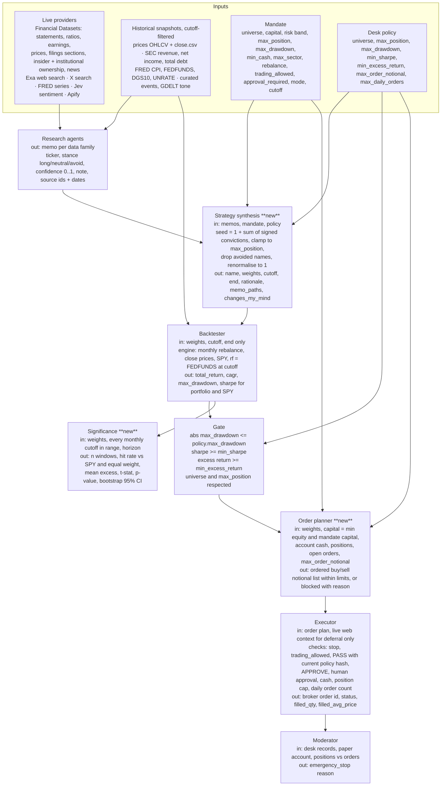

# Agent flow and variables

Two views of the trading system as it exists on `main` plus the synthesis layer being added
in `backend/app/synthesis/`. Roles and tools come from `backend/app/roles.py`; gates from
`backend/app/desk.py`; execution from `backend/app/paper.py`. Items marked **new** are the
synthesis-layer additions.

## 1. High-level flow

```mermaid
flowchart LR
    H[Human: fund + mandate + desk policy] --> O[Orchestrator]
    O --> R1[Research: fundamentals]
    O --> R2[Research: price / technical]
    O --> R3[Research: macro]
    O --> R4[Research: sentiment / news / X]
    O --> R5[Research: geopolitics / events]
    R1 & R2 & R3 & R4 & R5 --> A1[Adversarial review of research]
    R1 & R2 & R3 & R4 & R5 --> RB[(Research bundle: dated memos + sources) **new**]
    RB --> S[Strategy synthesis **new**<br/>memos + mandate -> frozen target weights]
    S --> REG[register_strategy: immutable strategy_id]
    REG --> A2[Adversarial review of strategy: APPROVE / CHANGES_REQUESTED]
    A2 -->|APPROVE| B[Blind backtester<br/>only run_backtest, only the strategy_id]
    B --> G{Backend gate<br/>drawdown, Sharpe, excess return, mandate}
    G --> SIG[Walk-forward significance **new**<br/>every cutoff, hit rate, t-stat, CI]
    G -->|FAIL| S
    G -->|PASS| HA[Human approval]
    HA --> P[Order planner **new**<br/>weights x capital - current positions -> notional orders]
    P --> E[Executor: submit_paper_order to Alpaca paper]
    E --> M[Moderator: inspect desk + account, emergency_stop]
    M -.->|stop| E
```

Gates the model cannot bypass: a strategy must be registered (frozen) before review; the
backtester is created only after an approving review and sees nothing but the weights and
dates; the backend computes PASS/FAIL from human thresholds; execution rechecks permission,
PASS, review, approval, limits and the stop before every order; a submitted order is not a
fill.

## 2. Which variables each agent uses



## 3. How this maps onto the roles on `main`

Kushagra's written role requirements take priority over the picture: the roster is flexible,
one root can create more orchestrators and task-focused researchers, and the boxes above are
context, not a fixed roster. The synthesis boxes are **tools on existing roles**, not new
roles: `synthesize_strategy` on the strategy role, `plan_paper_orders` and
`execute_order_plan` on the executor role. The executor's `execute_order_plan` submits a plan
one order at a time through the guarded adapter, halts at the first blocked or uncertain
order, and resumes after `alpaca_paper_order` confirms the open order's real fill.

**Two evaluations, one contract.** Synthesis hands every evaluator the same frozen strategy
record (`weights`, `cutoff`, `end`) by `strategy_id`. The desk gate on `main` runs the
monthly-rebalance snapshot engine to 2025-06-30 and decides PASS/FAIL against the human
policy. Mayank's walk-forward harness (D21, D22, accepted) is the leakage-safe evaluation
shown beside it: weekly decisions from 2025-10-03 on Claude Opus 4.6, whose documented
cutoff precedes the window, strict point-in-time data, and a memorization audit. Its
registered adapters `synthesis_seed` and `synthesis_planner` wrap the synthesis seed and
order planner, and its conformance suite proves they are pure functions of the
point-in-time view. His frozen run shows the agent pipeline trailing equal weight over 47
clean weeks; the method is the strength. The significance report stays as an
allocation-robustness add-on.

## 4. Known limits to state in the demo

- Historical evaluation is the recorded monthly target-weight engine on cached closes: no
  dividends, no costs, fully invested. Significance is a walk-forward across cutoffs with
  the same frozen weights, which measures robustness of the allocation, not of a live
  rebalancing process.
- Live provider data is not point-in-time safe and never feeds a historical decision.
- Model-memory leakage is not removed by hiding research from the evaluator; see
  Mayank's `docs/track3-plan.md` for the masked-ticker audit.
- Alpaca paper is a shared account; a submitted order is not a fill.
